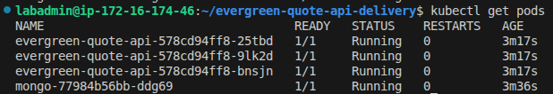
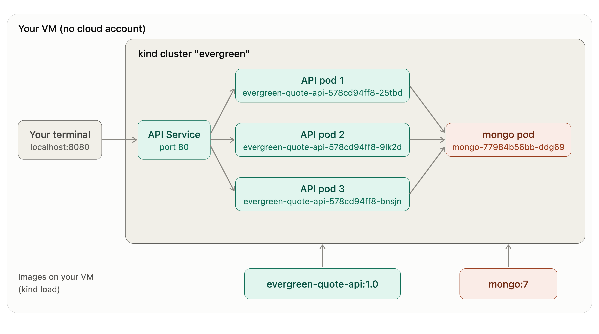

# Delivery Review: Evergreen Quote

## Slide 1: Delivery goal & did we hit it?

- **Goal:** By Thursday end of day, the Evergreen Quote API (REST and GraphQL, backed by MongoDB) is merged to `main` through a reviewed pull request with a green CI run, and demonstrated running in a container and on a local Kubernetes cluster.
- **Hit?** ☒ Yes  ☐ Partially  ☐ No
- **Why:** Full scope shipped, with one deliberate deferral: renters coverage, offered to the partner as the first item of the next delivery window.

## Slide 2: What shipped

A working Evergreen Quote API with two front doors: REST for the website and GraphQL for partners, both reading and writing the same MongoDB. It was merged to `main` through reviewed pull request #12 with a green build, and it ran three ways: on the dev server, in a container, and on a local Kubernetes cluster.

- **It answers and prices correctly.** The service reports that it's healthy, a known seeded quote (`q1`) can be looked up, and a new auto quote comes back with correct monthly premium. 
- **Partners can use it through GraphQL.** The GraphQL layer is mounted alongside REST, with a built-in explorer at `/explorer` where a partner can list quotes, look one up, or create a new one. 
- **It's safe to merge.** Merged PR: #[12](https://github.com/asc1-student07/evergreen-quote-api-delivery/pull/12) · CI run on the merge commit: [green](https://github.com/asc1-student07/evergreen-quote-api-delivery/actions/runs/43228081865). Each run installs exactly what the lock file specifies and runs the tests against a throwaway database, so a green build is a real check.
- **It runs the same everywhere.** One image ran on the dev server, in a container, and on the cluster. Only the configuration changed, never the code.
- **Cluster demo.** Three copies of the API sat behind one Service, all talking to one MongoDB. The first request through the Service returned an empty list, because the cluster's database was brand new, and then the first quote posted through it worked.

## Slide 3: Two key decisions

- **Deferred renters coverage (issue #11).** The partner called it "just one more dropdown option," but in this API the database schema is the contract: the coverage list, rates, seed data, tests, GraphQL schema and site dropdown all have to change together. Saying yes would have cost [something comes out: e.g., container work and/or cluster demo]. I deferred it and gave the partner a date - the first item of the next delivery window.
- **Deferred the base-image CVE fix (issue #10).** The CVE is moderate, the API is not internet-exposed this week, and the patched `node:22-alpine` tag deploys next week. An unscheduled base swap mid-delivery was the riskier move, so I shipped on the current base and booked the rebuild as the next window's first task. If exposure changes before Friday, hold.

## Slide 4: Risks & injects

- **Top risk tracked (R1):** AI-assisted code looks right but calculates wrongly. It happened Tuesday: the AI-generated POST handler passed the premium inputs in the wrong order and returned a normal-looking 201 for $0.35 a month on $50,000 of coverage. `npm test` caught it, and the kit's one-line fix closed it. 
- **Inject #1, R4 in action:** the partner's renters request ("just one more dropdown option") plus a moderate CVE on `node:22-alpine`. I sized each request, traded it against the plan in writing, deferred renters (#11) and shipped on the current base image (#10). 
- **Inject #2 (Wed):** `main` went red after a hotfix to widen the age range for the senior campaign (run #31): 2 of 7 tests failed, both POSTs returning 400 instead of 201. The red run meant the change was stopped at the gate, so nothing shipped. I read the CI log, named the failure in plain English, and routed it to the owner, asking whether the hotfix will be reverted or fixed. My branch was green and the hotfix isn't on it, so I made the call **go with conditions**: I won't merge onto a broken `main`, and I hold if it is was still red at 09:30 Thursday.

## Slide 5: What I'd do differently next round

- Do a better job cleaning up. Twice when I connected to MongoDB, it crashed with `EADDRINUSE: address already in use :::3000`, meaning something else was already holding the port. I read it as a problem with unknown origin, and wasted time before checking what was running. Looking at what was running would have settled it in about a minute, so that's now the first thing I do when I sit down to work.
- Run #31 (the incident) showed me that our safeguard depended on people following it. The tests ran and caught the problem, but nothing in the setup made a red result stop anyone, so a hotfix with 2 of 7 tests failing still ended up on `main`. Next round I'd address that. In the repository, I'd ask the platform owner to make a pull request and a passing build the only way onto `main`, with no exceptions for urgent fixes. In the team's habits, I'd agree in week one what a hotfix looks like (a short-lived branch, a quick review, the same green check), and who reverts when `main` goes red, so that nobody is deciding that in the middle of an incident.

## Q&A prep: likely questions

- *"Why leave a wrong quote in the database?"*
  No customer or partner could see it, and Tuesday's job was a working service. I didn't hand-edit it, because manual edits leave no record. I logged it (R5), set a rule to reset first if anyone outside the team was about to see the data, and Thursday's planned reset cleared it.
 
- *"The demo returned a normal-looking 201; why does one red test matter?"*
  Because nothing on the screen looked wrong. The only broken thing was the number inside the 201: $0.35 a month for $50,000 of coverage. The test compared the API's answer to the shared rate table and failed on it. The tests did the math the demo couldn't.
 
- *"Why go ahead with `main` red?"*
  Nothing shipped: the red run stopped the hotfix at the gate. My own branch was green and the hotfix isn't on it, so the incident didn't block my work. But a clean merge doesn't prove the combined code is correct, so I set conditions in writing: I won't merge onto a red `main`, and I hold if it's still red at 09:30 Thursday.
 
- *"Why didn't you ship renters? It's one dropdown option."*
  The partner called it "just one more dropdown option," but in this API the coverage list lives in the database schema, so the rates, seed data, tests, GraphQL schema and site dropdown all change with it. [What came out if I'd said yes: ___.] I gave the partner a date instead: [first item next window].
 
- *"Why ship on a base image with a known CVE?"*
  It's moderate severity, the platform team said the API isn't internet-exposed this week, and the patched tag lands in their normal window next week. They couldn't move it sooner. I deferred the fix (#10) and booked the rebuild for next window. [Add your sponsor's confirmation if you have it.]

 